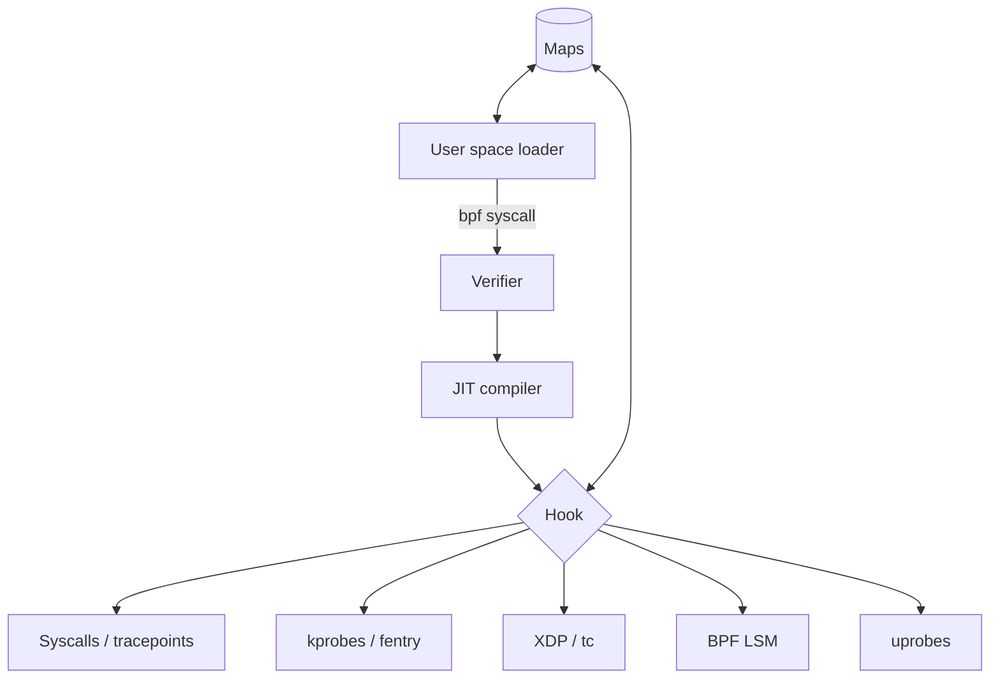

# eBPF as Sensor and Attack Surface: Problem and Threat Model

eBPF lets privileged users load small programs into the running Linux kernel and attach them to almost any event: system calls, kernel functions, network packets, user-space function entry points, security hooks. The same property that makes it the foundation of modern runtime security tools makes it attractive to attackers. A program that can see every `execve` can also lie about it. This book treats eBPF from both sides: as the sensor defenders rely on, and as a programmable layer that must itself be defended.

## Why this matters now

eBPF began as an extension of the classic Berkeley Packet Filter used by `tcpdump`. Jeff Dileo's DEF CON 27 talk "Evil eBPF: Practical Abuses of an In-Kernel Bytecode Runtime" (2019) summarised the shift: classic BPF was a tiny filter language with two 32-bit registers, while eBPF is a general virtual instruction set "designed to be JITed with one to one mapping", featureful enough to compile restricted C, and exposed through the `bpf(2)` system call. Pat Hogan's DEF CON 29 talk "Warping Reality" quoted Isovalent's Thomas Graf describing it as adding "JavaScript-like capabilities to the Linux Kernel".

Today eBPF underpins container networking (Cilium), observability (bpftrace, BCC), and security products. Falco, Tetragon and Tracee all collect events through eBPF (Chapter 3). Cloud vendors and endpoint products rely on it. At the same time, public research since 2019 has shown how eBPF can be used to hide processes and files, tamper with what user-space tools read, intercept TLS traffic through user probes, and run covert command channels (Chapter 4). Classic-BPF socket filters have also been abused by malware in the wild: Trend Micro and others have documented the BPFDoor backdoor, attributed by PwC to a group it calls Red Menshen, using cBPF filters to wake on "magic" packets without binding a port.

## Two roles, one mechanism

| Role | What eBPF provides | What can go wrong |
|---|---|---|
| Sensor | Low-overhead visibility into syscalls, processes, files, network | Sensor is blind, bypassed or tampered with |
| Enforcer | Block or kill at the kernel hook (BPF LSM, Tetragon enforcement, XDP drop) | Policy bypass, denial of service |
| Attacker tool | Same hooks, used to hide, tamper and exfiltrate | Rootkit behaviour without a kernel module |
| Kernel attack surface | Verifier and JIT are complex code reachable by loaders | Verifier bugs lead to kernel memory corruption |

## Threat model

State these assumptions explicitly for any host that runs eBPF tooling.

**Who can load programs?** Most powerful program types need `CAP_BPF` plus `CAP_PERFMON` or `CAP_NET_ADMIN` (kernel 5.8 and later), or `CAP_SYS_ADMIN` on older kernels. Unprivileged loading of socket filters is controlled by the `kernel.unprivileged_bpf_disabled` sysctl (Chapter 6). If an attacker already has root, eBPF is one of many persistence and stealth options; if they do not, eBPF matters mainly through verifier bugs and misconfigured delegation.

**What do defenders trust?** If your detection runs as an eBPF program, its integrity depends on nothing else with BPF privileges tampering with it, and on the kernel itself being intact.

**What survives reboot?** eBPF programs live in kernel memory. As Hogan's talk notes, they must be reloaded after every reboot, so persistence requires a loader on disk, a systemd unit, or a modified image. That loader is a detection point.

**What does the kernel log?** Some risky helpers trigger warnings. Fournier, Afchain and Baubeau ("eBPF, I thought we were friends!", DEF CON 29, 2021) showed that loading a program using `bpf_probe_write_user` prints a kernel message warning that it "may corrupt user memory", visible in `dmesg` and the journal, unless the attacker also suppresses it.

## Scope and rules

This book describes attack techniques at the level public talks and papers do, so that defenders can detect them. It contains no rootkit code. Practise on lab virtual machines you own. Do not load experimental eBPF programs on production hosts or systems you are not authorised to administer, and report verifier or tool vulnerabilities through the kernel security team or the project's disclosure process. For fuzzing the verifier itself, see **kernel-hypervisor-fuzzing-ai**.

## Worked example

*Execution status: not executed in this book's CI; verify locally.*

Inventory eBPF exposure on a lab VM.

1. Boot a recent Ubuntu or Fedora VM. Check the kernel version with `uname -r` and BPF config with `grep -E 'CONFIG_BPF(_SYSCALL|_LSM|_JIT|_UNPRIV_DEFAULT_OFF)=' /boot/config-$(uname -r)`.
2. Read `sysctl kernel.unprivileged_bpf_disabled net.core.bpf_jit_enable net.core.bpf_jit_harden`.
3. Install `bpftool` (package `bpftool` or `linux-tools-$(uname -r)`) and run `sudo bpftool prog show` and `sudo bpftool map show`. Note which programs systemd or other services already load.
4. Check the active LSM list with `cat /sys/kernel/security/lsm` and see whether `bpf` appears.
5. Write down who on the host holds `CAP_SYS_ADMIN` or `CAP_BPF` (users, containers, agents).

## Common pitfalls

- Assuming "the verifier makes eBPF safe" means safe from abuse by privileged users; it means the program should not crash the kernel.
- Running security agents and untrusted privileged containers on the same host.
- Ignoring the loader binary and service units that make eBPF persistent.
- Treating the absence of `bpftool` output anomalies as proof of a clean host when the attacker may control `bpftool`'s view.
- Forgetting classic BPF socket filters in threat models.

## Exercises

1. Produce the inventory above for two kernels (an LTS and a recent mainline) and compare default sysctl values.
2. List every process on a Kubernetes lab node that holds `CAP_BPF` or `CAP_SYS_ADMIN`.
3. Read the Fournier et al. DEF CON 29 slides and list each attacker capability alongside the hook and helper it relies on.

## Further reading

- Jeff Dileo, "Evil eBPF: Practical Abuses of an In-Kernel Bytecode Runtime", DEF CON 27 (2019)
- Guillaume Fournier, Sylvain Afchain, Sylvain Baubeau, "eBPF, I thought we were friends!", DEF CON 29 (2021)
- Pat Hogan, "Warping Reality: Creating and Countering the Next Generation of Linux Rootkits Using eBPF", DEF CON 29 (2021)
- eBPF documentation hub: <https://ebpf.io>
- Trend Micro, "BPFDoor's Hidden Controller" (2025): <https://www.trendmicro.com/en_gb/research/25/d/bpfdoor-hidden-controller.html>
- Related books: **kernel-hypervisor-fuzzing-ai**
